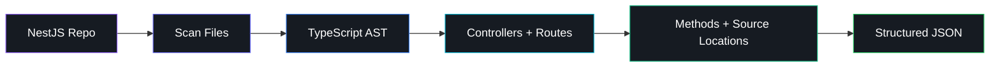

  

---

## About

**Computer Engineering @ University of Waterloo**  
**Software Engineering Intern @ Shopify**

I like building software across **backend systems, developer tools, infrastructure, and embedded systems**.

Currently seeking **Summer 2027 Software Engineering internships**.

---

## Experience

<table>
<tr>
<td width="50%" valign="top">

### Shopify

**Software Engineering Intern** · Fall 2026

Working within **Organizations → Foundations** on migration work for Shopify's Business Details experience.

`Ruby` `Ruby on Rails` `Production Systems`

</td>

<td width="50%" valign="top">

### Dasens

**Software Engineering Intern** · Jan–Apr 2026

Built full-stack features, automation workflows, and AI-backed product systems.

`TypeScript` `Next.js` `n8n` `Kubernetes`

</td>
</tr>
</table>

---

## Featured Build

### 🧭 Codebase GPS

A developer tool for navigating unfamiliar NestJS repositories through static analysis.

`TypeScript` `ts-morph` `NestJS` `fast-glob`

---

## Projects

<table>
<tr>

<td width="50%" valign="top">

### ⠿ Braillink

Portable text-to-Braille display powered by an **STM32** and electronically controlled solenoids.

`C` `STM32` `SPI` `GPIO`

</td>

<td width="50%" valign="top">

### 🎧 Podcastify

Full-stack application that turns uploaded educational material into audio.

`Python` `Flask` `Vue.js` `REST APIs`

</td>

</tr>
</table>

---

## Stack

 

**Also worked with:**  
`STM32` · `n8n` · `Neo4j` · `Qdrant` · `Airtable` · `Baserow` · `REST APIs` · `PyTorch` · `OpenCV`

---

## Outside of Code

**Mentorship Director · Waterloo Women in Engineering**

Helping run mentorship programming, matching, communication, and events for engineering students.

---

### let's build something useful.

[**mayuriagarwal.com**](https://mayuriagarwal.com)

